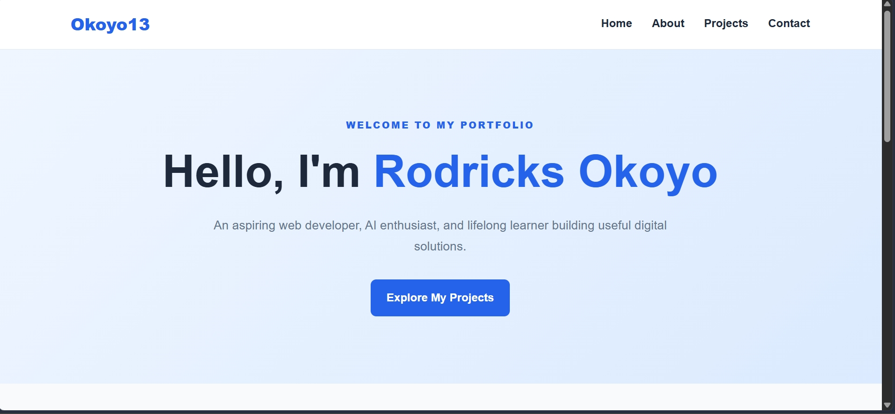

# Rodricks Okoyo - Week 03 Project

## Project Description

This is my Week 03 portfolio project for the IYF program. The project focuses on building a personal portfolio website using HTML5 and CSS3, organizing project files, and practicing Git and GitHub workflows.

## 🌐 My Portfolio

Check out my live portfolio:

[**View My Portfolio**](https://okoyo13.github.io/iyf-s12-week-03-okoyo13/)

> Note: GitHub Pages is enabled for this repository. Open the link above to view the live page.

## Screenshot



## Features

- Responsive layout for desktop and mobile devices
- Semantic HTML structure and accessible navigation
- Single-page portfolio with Home, About, Projects, and Contact sections
- Project cards showcasing learning projects
- Email contact link
- Mobile navigation menu powered by JavaScript

## Technologies Used

- HTML5
- CSS3 (Flexbox and Grid)
- Git
- GitHub

## Project Structure

```text

├── docs/
├── src/
│   ├── css/
│   │   └── style.css
│   ├── images/
│   │   └── screenshot.png
│   ├── js/
│   │   └── script.js
│   └── index.html
├── tests/
├── .gitignore
├── LICENSE
└── README.md

```

## What I Learned

- How to organize a web development project into folders.
- How to structure web pages using HTML5.
- How CSS can be used to style and create responsive layouts.
- How to use Git and GitHub to manage and share project work.
- Why a clear README is important for documenting a project.

## Future Improvements

- [ ] Add more portfolio projects as I complete them.
- [ ] Improve JavaScript interactivity.
- [ ] Implement dark mode.
- [ ] Add project filtering.
- [ ] Test accessibility and responsiveness on different devices.

## Contact

- **Email:** okoyorodricks@gmail.com
- **LinkedIn:** [Rodricks_okoyo](https://www.linkedin.com/in/rodricks-okoyo-218960255/)
- **GitHub:** [@okoyo13](https://github.com/okoyo13)

## Collaboration Section.

- **Partner:** [Wilfred-Mutuma](https://github.com/Wilfred-Mutuma)
- **Pair Repository:** [Pair Repository](https://github.com/okoyo13/iyf-s12-week-03-pair-okoyo13)
- **PR I Opened:** [My Profile Pull Request](https://github.com/okoyo13/iyf-s12-week-03-pair-okoyo13/pull/1)
- **PR I Reviewed:** [Partner's Profile Pull Request](https://github.com/okoyo13/iyf-s12-week-03-pair-okoyo13/pull/3)
- **Merge-Conflict PR:** [README Merge-Conflict Pull Request](https://github.com/okoyo13/iyf-s12-week-03-pair-okoyo13/pull/2)

## License

This project is open source and available under the [MIT License](LICENSE).
